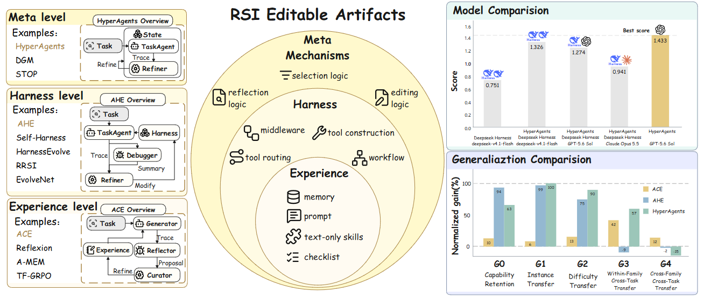
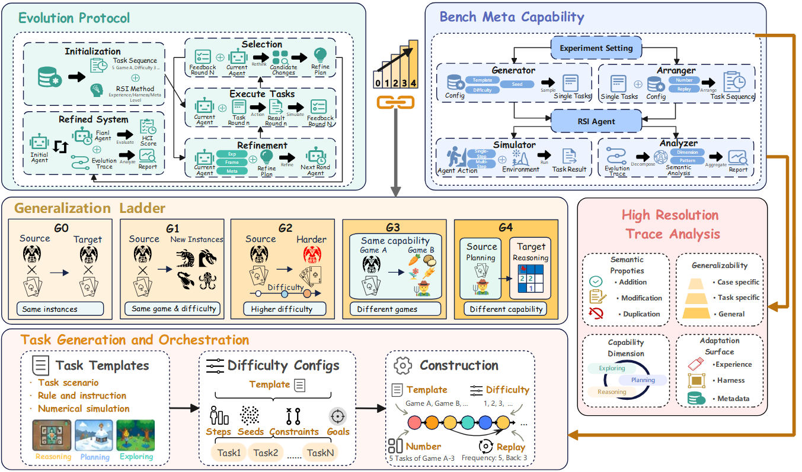

# SelfImprove-Bench: Evaluating Generalization in Self-Improving Agents

<p align="center">
  <a href="https://arxiv.org/pdf/2611.02797"></a>
  <a href="https://huggingface.co/datasets/DreamEternal/SelfImprove-Bench-Cases"></a>
  <a href="./LICENSE.txt"></a>
</p>

<p align="center">
  <b>If you like our project, please give us a star ⭐ on GitHub for the latest update.</b>
</p>



## ✨ Introduction

The above project provides a benchmark for RSI. Its protocol supports multiple representative RSI methods to self-evolve from feedback on multi-round tasks, and provides task generation, simulation, and evaluation through six game scenarios across three capability categories. With a scalable task generation and orchestration mechanism, the benchmark can measure the effectiveness of RSI methods at different levels of generalization and offers better sustainability.

- **Generalization Ladder**: Organize evaluation into generalization ladder levels G0 to G4: same instances (G0), unseen instances at the same difficulty (G1), new difficulty levels within the same task (G2), different tasks within the same capability category (G3), and tasks across capability categories (G4).
- **Scalable Task Generation and Orchestration**: Automatic generate task istances based on templates and difficuly coefficients, enabling configurable task sequences for evaluating each level of the generalization ladder.
- **High Resolution Trace Analysis**: Characterize refinement semantics, modification scope, capability dimension, and generalizability from evolution trajectories, enabling a more comprehensive reflection on the method pattern..

The initial version covers following methods and games, while you can extend new ones based on the extensible framework.
- **Methods:** RSI framework (ACE, AHE, HyperAgents) and baselines (Codex, Claude Code, Deepseek Harness).
- **Games:** Farm, Combat, Sweepmine, Hero's Journey, Minecraft, Astray.



## ⚙️ Setup

Run the following from the repository root:

```bash
conda create -n rsi-bench python=3.13.12
conda activate rsi-bench
pip install -r requirements.txt
```

Additional dependencies depend on the method and games:

```bash
# HyperAgents
pip install -r rsi_methods/HyperAgents/requirements.txt

# Minecraft and Astray
pip install -e ./benches/gameworld/assets/core/code
playwright install chromium

# AHE (Linux; unprivileged user namespaces must also be enabled)
sudo apt-get install bubblewrap
```

AHE requires filesystem sandbox support and a successful Agent Debugger
diagnosis before each refinement. It stops if either is unavailable.
NexAU is bundled locally and installed by `requirements.txt`.

**Headless Linux rendering:** If Chromium fails to initialize WebGL or a game
remains stuck on its loading screen, set `GAMEWORLD_RENDERER=swiftshader`
before running the benchmark to use software rendering. Leave it unset to use
Chromium's default renderer. SwiftShader may run more slowly.

Configure model credentials through environment variables:

```bash
export OPENAI_API_KEY="YOUR_API_KEY"
export OPENAI_BASE_URL="YOUR_API_BASE_URL"
```

Set each method's model and backend in `rsi_methods/<METHOD>/config.toml`;
benchmark `agent.model` does not override these settings.

HyperAgents runs in Docker. If your model proxy is available only at the
host's `127.0.0.1`, set `HYPERAGENTS_DOCKER_NETWORK=host` on Linux, or
configure a proxy address reachable from the container.

## 💻 Usage

The 18 configurations in [`configs/main/`](configs/main/) cover all six games
and three methods. For example:

```bash
# Train ACE on Farm and evaluate the final framework
python -m benchmark configs/main/farm_ace.json

# Evaluate the initial framework on the same held-out tasks
python -m benchmark configs/main/farm_ace.json --initial

# Resume an interrupted run
python -m benchmark configs/main/farm_ace.json --resume
```

Replace `ace` with `ahe` or `hyperagents` to use another method.
Results, trajectories, task manifests, method artifacts, and checkpoints are
saved under the configured `output_dir`.

See the [experiment guide](configs/main/README.md) for task groups and metrics,
and the [resume guide](benchmark/RESUME.md) for checkpoint recovery.

### Experiment Configuration

Training, held-out evaluation, and replay are configured in one JSON file:

```json
{
  "seed": 20260915,
  "schedule": [
    {"game": "farm", "difficulty": 3, "count": 20, "replay": true}
  ],
  "holdout": [
    {"game": "farm", "difficulty": 3, "count": 20},
    {"game": "farm", "difficulty": 5, "count": 20},
    {"game": "combat", "difficulty": 3, "count": 20}
  ],
  "replay": {"every": 5, "lag": 3},
  "holdout_seed": 100,
  "holdout_tasks_per_difficulty": 20,
  "agent": {
    "provider": "rsi",
    "adapter": "rsi_methods.ACE.ACEAdaptor:ACEAdaptor",
    "timeout": 1800,
    "max_attempts": 3
  },
  "output_dir": "outputs/my_farm_ace",
  "continue_on_error": true
}
```

- **Training (`schedule`):** each entry specifies a game, difficulty, and task
  count. This example runs 20 difficulty-3 Farm tasks with refinement.
- **Evaluation (`holdout`):** entries use the same game/difficulty/count format.
  This example evaluates 20 tasks each for same-difficulty, harder, and
  cross-game performance, without refinement. `holdout_seed` controls task
  generation; `holdout_tasks_per_difficulty` must cover each group's count.
- **Replay (`replay`):** enable it with `"replay": true` in a training entry.
  Here, every 5 normal training tasks, the framework revisits the task from
  3 training rounds earlier: tasks 2, 7, 12, and 17 after rounds 5, 10, 15,
  and 20. Replays reuse the original tasks without refinement and do not
  count toward the 20 training tasks. To disable replay, omit both replay settings.

`agent` selects the method and request limits; `output_dir` selects where the run
is saved. Use `--initial` with the same config to evaluate the untrained framework
on the same holdouts. Game IDs are `farm`, `combat`, `sweepmine`,
`heros_journey`, and `gameworld` (Minecraft/Astray).

For Minecraft/Astray, `game_options.gameworld.train` and `.holdout` specify the
actual game/task IDs, and `max_steps` limits actions per episode. Start from a
matching config in `configs/main/` rather than changing only the top-level game ID.

### Analyze Results

```bash
python -m analyze ace outputs/main/farm/ace --model MODEL --output farm_ace_analysis.json
python -m analyze ahe outputs/main/farm/ahe --model MODEL --output farm_ahe_analysis.json
python -m analyze hyper outputs/main/farm/hyperagents --model MODEL --output farm_hyperagents_analysis.json
python -m benchmark.aggregate_results --input RUN_DIRS --output-dir OUT
```

Calculate HCI using a trained run and its matching initial evaluation:

```bash
python -m benchmark.hci --trained outputs/main/farm/ace --initial outputs/main/farm/ace_initial --output analysis/farm_ace_hci.json
```

Use `python -m analyze --help` for trajectory analysis and reporting commands.

### Expand to an new RSI Method

Implement [`RSIMethod`](benchmark/interfaces.py) and configure its import path:

```json
{
  "agent": {
    "provider": "rsi",
    "adapter": "my_method.adapter:MyAdapter",
    "adapter_options": {},
    "model": "YOUR_MODEL"
  }
}
```

The adapter owns method initialization, acting, refinement, and state
persistence. Games own observations, actions, simulation, and scoring; adding
a method does not require changing game code.

See [`examples/minimal_rsi.py`](examples/minimal_rsi.py) for an offline lifecycle
example and [`benchmark/contracts.py`](benchmark/contracts.py) for shared data
types. Run the example with:

```bash
python -m benchmark configs/examples/minimal_rsi.json
```

## 📊 Repository Layout

| Directory | Contents |
|---|---|
| `benchmark/` | Experiment runner, interfaces, metrics, and checkpoints |
| `benches/` | Game environments and scoring |
| `rsi_methods/` | ACE, AHE, and HyperAgents adapters |
| `configs/` | Experiment configurations |
| `analyze/` | Trajectory analysis and reports |
| `tests/` | Regression tests |

## 📚 Citation
If you find this project useful for your research, please consider giving us a star and citing our paper:

```bibtex
@article{xu2026selfimprovebench,
  title={SelfImprove-Bench: Evaluating Generalization in Self-Improving Agents},
  author={Bangrui Xu and Jie Yang and Sidi Chen and Xuanhe Zhou and Jiantao Qiu and Qianyu Yang and Zijie Wang and Fan Wu and Zhoufutu Wen},
  journal={arXiv preprint arXiv:2611.02797},
  year={2026}
```

## 📄 License
This project is licensed under the MIT License. See the [LICENSE](./LICENSE) file for details.
Bundled third-party components retain their own licenses:

| Component | License / terms |
|---|---|
| ACE | [Apache-2.0](rsi_methods/ACE/ace/LICENSE.txt); see [modifications](rsi_methods/ACE/ace/MODIFICATIONS.md) |
| AHE | [MIT](rsi_methods/AHE/agentic-harness-engineering/LICENSE) |
| NexAU | Apache-2.0; see [bundled distribution details](third_party/nexau/README.md) |
| HyperAgents | [CC BY-NC-SA 4.0](rsi_methods/HyperAgents/hyperagents/LICENSE.md), non-commercial use only |
| Hero's Journey | [MIT](benches/heros_journey/HerosJourney/LICENSE) |
| GameWorld runtime and games | Adapted from [GameWorld](https://github.com/gameworld-project/gameworld); bundled game assets are for research and educational use only. See [attribution and terms](benches/gameworld/README.md). |

The repository's MIT License does not override third-party terms.
